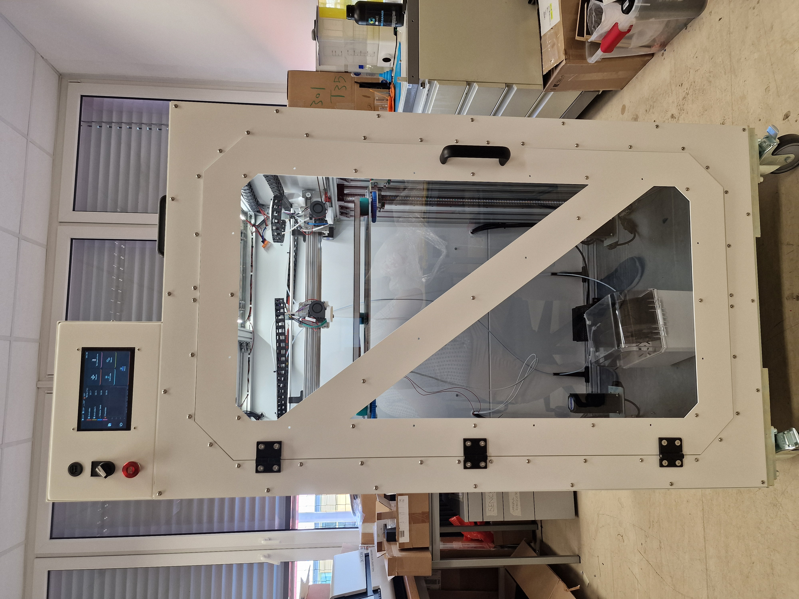
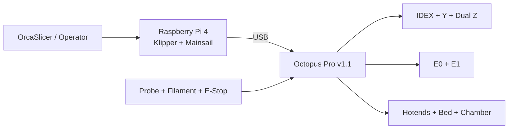
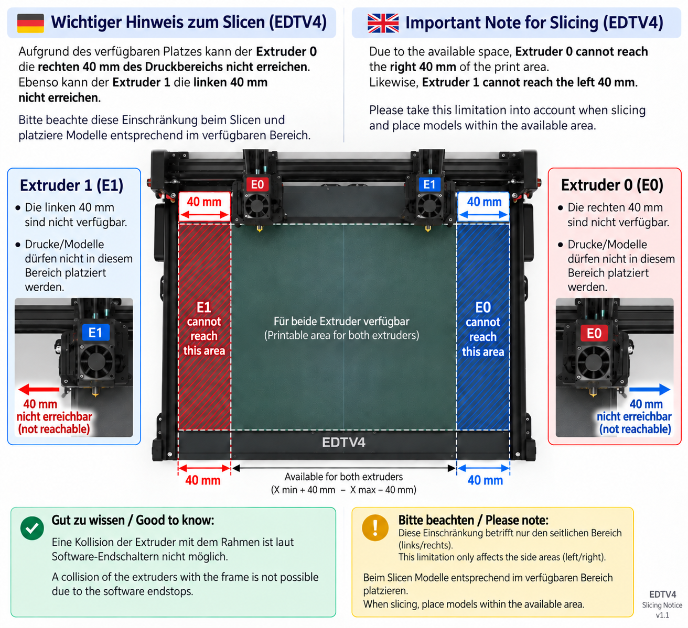
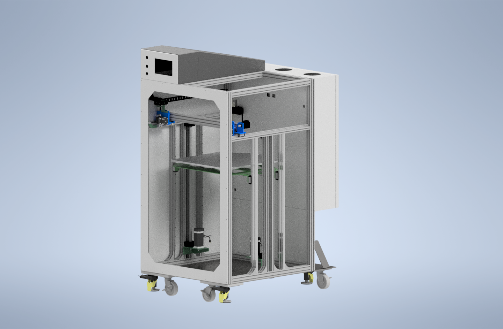
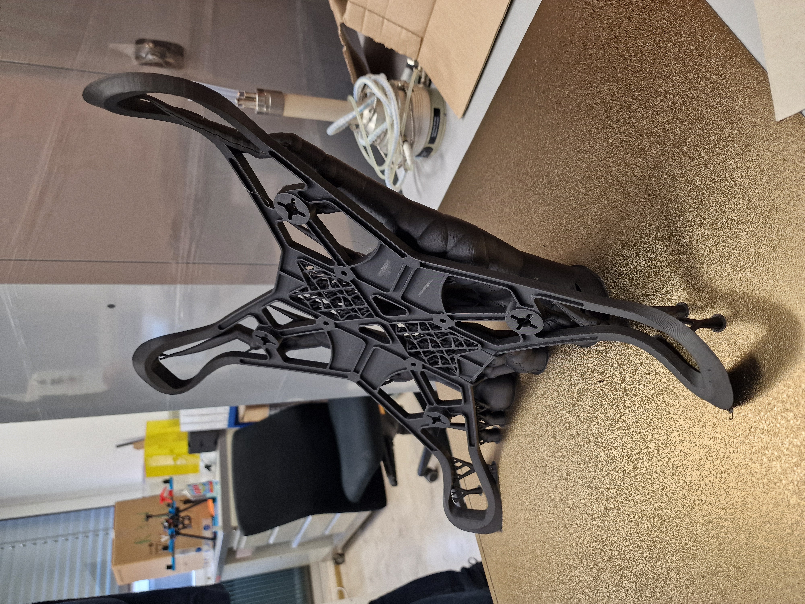

# EDTV4

## Large-format IDEX FFF research platform

<p align="center">
  
</p>

**EDTV4** is a custom large-format, enclosed **Independent Dual Extrusion (IDEX)** FFF platform developed at the University of Applied Sciences Upper Austria (FH OÖ), Wels. The project combines mechanical design and manufacturing, electrical integration, Klipper firmware, machine-specific OrcaSlicer profiles and a heated build environment in one research-oriented machine.

This repository provides the current machine configuration, manufacturing data, neutral CAD assembly, public bill of materials, technical documentation and the tested slicer profiles used with the completed system.

> **Configuration authority:** when documentation and older project material disagree, the current [`printer.cfg`](firmware/klipper/printer.cfg) is the authoritative source for installed firmware settings and configured machine limits.

---

## Project at a glance

| | |
|---|---|
| Architecture | Enclosed Cartesian IDEX |
| Main controller | BIGTREETECH Octopus Pro v1.1 / STM32H723 |
| Host | Raspberry Pi 4 |
| Firmware / UI | Klipper + Mainsail |
| Slicer | OrcaSlicer |
| X system | Two independent X carriages |
| Y system | Dual-motor Y axis |
| Z system | Dual Z drives + Z-tilt correction |
| Bed probing | 9 × 9 bicubic mesh |
| Thermal system | Dual hotends, heated bed, actively heated chamber |
| Monitoring | Filament switch + filament-motion sensor |
| Safety input | Hardware emergency stop |

### Current firmware limits

| Parameter | Current configuration |
|---|---:|
| E0 X travel | -59.5 ... 475 mm |
| E1 X travel | 35 ... 560.29 mm |
| Y travel | -46 ... 505 mm |
| Z travel | -2 ... 650 mm |
| Maximum XY velocity | 300 mm/s |
| Maximum acceleration | 1000 mm/s² |
| E0 configured max. temperature | 310 °C |
| E1 configured max. temperature | 300 °C |
| Heated-bed configured max. temperature | 130 °C |
| Chamber-heater configured max. temperature | 70 °C |

These are **configured machine limits**, not general print recommendations.

---

## System architecture



A more detailed architecture description is available in [`docs/system_architecture.md`](docs/system_architecture.md).

---

## IDEX slicing limitation

The independent X carriages do not have identical access to the complete nominal print area:

- **E0 / left carriage** cannot reach the rightmost **40 mm**.
- **E1 / right carriage** cannot reach the leftmost **40 mm**.

Klipper prevents the carriages from exceeding their configured travel limits, but model placement in OrcaSlicer still has to respect the reachable area of the selected toolhead.

<p align="center">
  
</p>

---

## Mechanical design and manufacturing data

The repository contains the final neutral STEP assembly together with available manufacturing data for the machine. Depending on the component, STEP, DWG and PDF files are provided for sheet-metal, milled, acrylic and electrical-enclosure parts.

<p align="center">
  
</p>

- [Hardware overview](hardware/README.md)
- [CAD and manufacturing files](hardware/cad/README.md)
- [Final STEP assembly](hardware/cad/EDTV4_Assembly_STEP.zip)
- [Public BOM](hardware/bom/README.md)

The STEP archive contains `EDTV4_Assembly_2026-10-13.stp`, exported from Autodesk Inventor 2020 using STEP AP214. Only public header metadata was cleaned; the geometry was not modified.

---

## Firmware and electronics

The current Klipper configuration is machine-specific and documents the installed EDTV4 wiring, motion configuration, thermal system, sensors and macros.

- [`firmware/klipper/printer.cfg`](firmware/klipper/printer.cfg) – current machine configuration
- [`firmware/klipper/macros.md`](firmware/klipper/macros.md) – readable macro reference
- [`docs/electronics_pinout.md`](docs/electronics_pinout.md) – Octopus Pro connector/pin overview derived from the firmware

Notable functions include custom IDEX homing and parking, Z tilt, automatic bed meshing, chamber control, filament monitoring, recirculation-fan control and a hardware emergency-stop input.

---

## OrcaSlicer profiles

Tested profile bundles are provided for:

- 0.4 mm nozzle
- 0.6 mm nozzle
- 1.0 mm nozzle

The profile contents and tool-change routines are intentionally kept **as tested**. They have not been normalized between nozzle sizes for publication. Only the original computer-local path to the optional bed-visualization model was removed.

See [`slicer/orcaslicer/README.md`](slicer/orcaslicer/README.md).

---

## Documentation

Start with the documentation index: **[`docs/README.md`](docs/README.md)**.

| Document | Purpose |
|---|---|
| [Project overview](docs/project_overview.md) | Machine concept and technical overview |
| [System architecture](docs/system_architecture.md) | Control, motion and thermal architecture |
| [Operation quick reference](docs/operation_quick_reference.md) | Concise reference for trained users |
| [Calibration & maintenance](docs/calibration_and_maintenance.md) | Calibration sequence and service intervals |
| [Electronics / pinout](docs/electronics_pinout.md) | Controller connections derived from firmware |
| [Klipper macro reference](firmware/klipper/macros.md) | Purpose of the custom EDTV4 macros |

### Operating manuals

Public operating manuals are included in German and English. They were rebuilt from the original internal documentation and updated against the current firmware configuration. Internal network information, student identifiers and superseded technical limits are not included.

- [Deutsch - EDTV4 Bedienungsanleitung](docs/manuals/EDTV4_Bedienungsanleitung_DE.md)
- [English - EDTV4 Operating Manual](docs/manuals/EDTV4_Operating_Manual_EN.md)

---

## Example print

<p align="center">
  
</p>

---

## Repository structure

```text
EDTV4/
├── docs/                 Technical and operating documentation
├── firmware/klipper/     Current Klipper configuration
├── hardware/
│   ├── bom/              Public BOM without prices
│   └── cad/              Assembly and manufacturing data
├── media/                Photos and CAD renders
└── slicer/orcaslicer/    Tested OrcaSlicer profile bundles
```

## Notes for reuse

EDTV4 documents one specific machine and its tested configuration. Before reusing firmware, electrical connections, heater settings or mechanical data on another machine, verify the target hardware independently.

Publication permission for the EDTV4 project files has been granted. **No open-source license has been selected for this repository yet**, so the repository should not be interpreted as granting reuse rights beyond applicable law and any explicit permission from the rights holders.

## License

EDTV4 uses different licenses for hardware, software and documentation:

- **Hardware design, CAD files, manufacturing drawings and BOM:**  
  [CERN-OHL-W-2.0](LICENSES/CERN-OHL-W-2.0.txt)

- **Klipper configuration, macros and software:**  
  [GPL-3.0](LICENSES/GPL-3.0-only.txt)

- **Documentation, manuals and original project media:**  
  [CC BY 4.0](LICENSES/CC-BY-4.0.txt)

Third-party logos, trademarks, screenshots and other externally sourced
material are excluded from these licenses.

See [LICENSE.md](LICENSE.md) for details.

## Project context and credits

- Developed at **University of Applied Sciences Upper Austria (FH OÖ), Campus Wels**.
- Project supervision: **Dr. Sascha Senck**.
- Machine documentation, repository preparation and technical project presentation: **Bernhard Edtmeier**.
