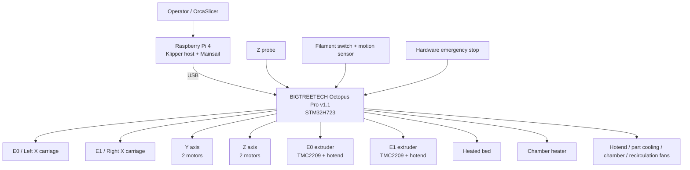
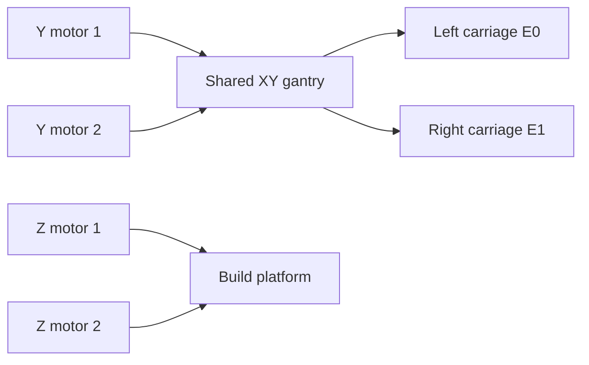
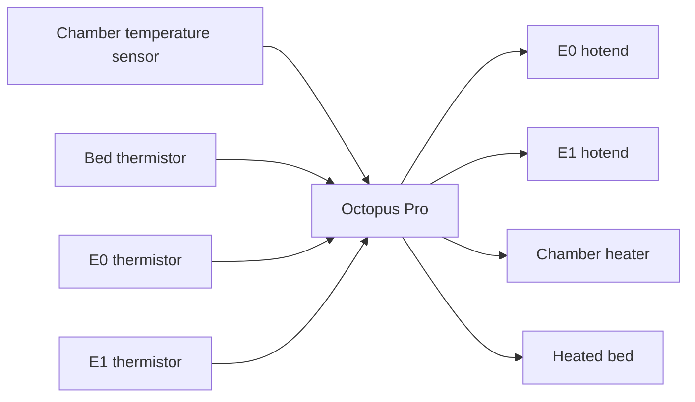

# EDTV4 System Architecture

The diagram below gives a high-level view of the EDTV4 control and machine architecture.

## Control flow

1. OrcaSlicer produces machine-specific G-code using one of the tested EDTV4 profile bundles.
2. The G-code is transferred to the Klipper host.
3. Klipper coordinates both X carriages, the shared Y/Z motion system, heaters, fans and sensors through the Octopus Pro controller.
4. Tool changes select the appropriate carriage and extruder, park the inactive carriage and restore the configured tool offset.

## Motion architecture

The two X carriages share the Y motion system but move independently along X. This enables independent dual extrusion while also creating different reachable X regions for E0 and E1.

## Thermal architecture

For the exact output and sensor-pin assignments, see [`electronics_pinout.md`](electronics_pinout.md).
